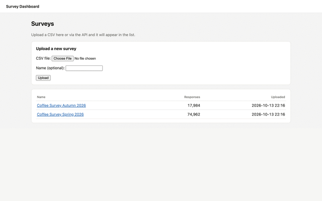
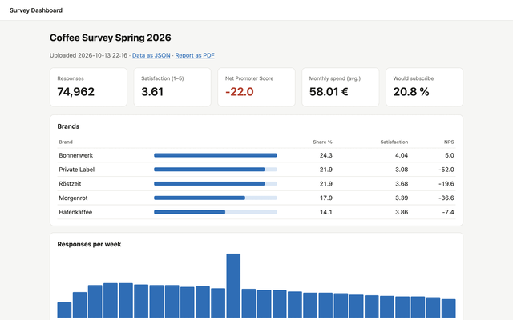
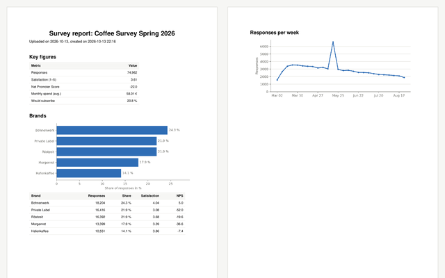

# Survey Dashboard

[](https://github.com/wollodev/survey-dashboard/actions/workflows/ci.yml?query=branch%3Amain)

> **Demo project** – a small, cleanly structured application built with **Python, Django and pandas**.
> All brands, people and answers are made up (`python manage.py generate_survey`).

A Django application for uploading, cleaning and analysing survey CSVs (coffee consumption in Germany).
The data is cleaned with pandas, stored as Parquet and presented as a dashboard, a JSON API
and a PDF report.

## Screenshots

<table>
  <tr>
    <td align="center" width="33%">
      <a href="docs/screenshots/list.png"></a><br>
      <sub><b>Survey list</b> and upload form</sub>
    </td>
    <td align="center" width="33%">
      <a href="docs/screenshots/dashboard.png"></a><br>
      <sub><b>Dashboard</b> with KPIs, brands, trends and breakdowns</sub>
    </td>
    <td align="center" width="33%">
      <a href="docs/screenshots/report.png"></a><br>
      <sub><b>PDF report</b> (matplotlib + ReportLab)</sub>
    </td>
  </tr>
</table>

Click a thumbnail to see the full-size image.

## Structure

| Module | Responsibility |
|---|---|
| `surveys/data/schema.py` | Columns, dtypes, allowed values |
| `surveys/data/importer.py` | Read and clean a CSV → `CleaningReport` |
| `surveys/data/analysis.py` | Metrics with pandas → `Summary` |
| `surveys/services.py` | Store uploads, cache summaries |
| `surveys/views.py`, `api.py` | HTML pages and JSON API |
| `surveys/charts.py`, `report.py` | Charts (matplotlib) and PDF (ReportLab) |

`surveys/data/` is pure pandas code and must not import Django (enforced by ruff).
Upload metadata lives in SQLite, the survey data in Parquet files – both under `DATA_DIR` (default: `data/`).

## Local development

```bash
python -m venv .venv && source .venv/bin/activate
pip install -r requirements-dev.txt
python manage.py migrate
python manage.py generate_survey          # creates survey.csv with 75,000 test responses
python manage.py runserver
```

`manage.py` uses `config.settings.dev`; `wsgi.py`/`asgi.py` use `config.settings.prod`.

### Checks

The same checks run in GitHub Actions for every pull request and every push to `main` (`.github/workflows/ci.yml`).

```bash
python manage.py test
ruff check . && ruff format --check .
mypy .
```

## Docker

```bash
cp .env.example .env    # set DJANGO_SECRET_KEY
docker compose up --build
```

## API

| Method | Path | Description |
|---|---|---|
| `GET` | `/api/surveys/` | List all uploads |
| `POST` | `/api/surveys/` | Upload a CSV (`file`, optional `name`), max. 20 per hour and IP |
| `GET` | `/api/surveys/<id>/summary/` | All metrics as JSON |

```bash
curl -F "file=@survey.csv" http://localhost:8000/api/surveys/
```

Other pages: `/surveys/<id>/` (dashboard) and `/surveys/<id>/report.pdf` (PDF report).
